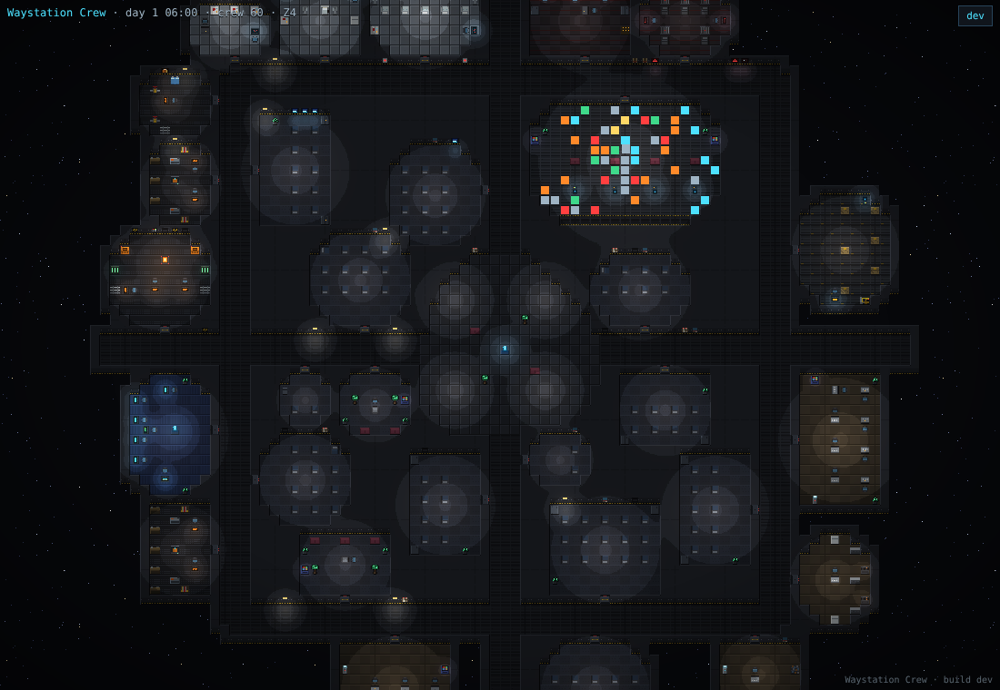
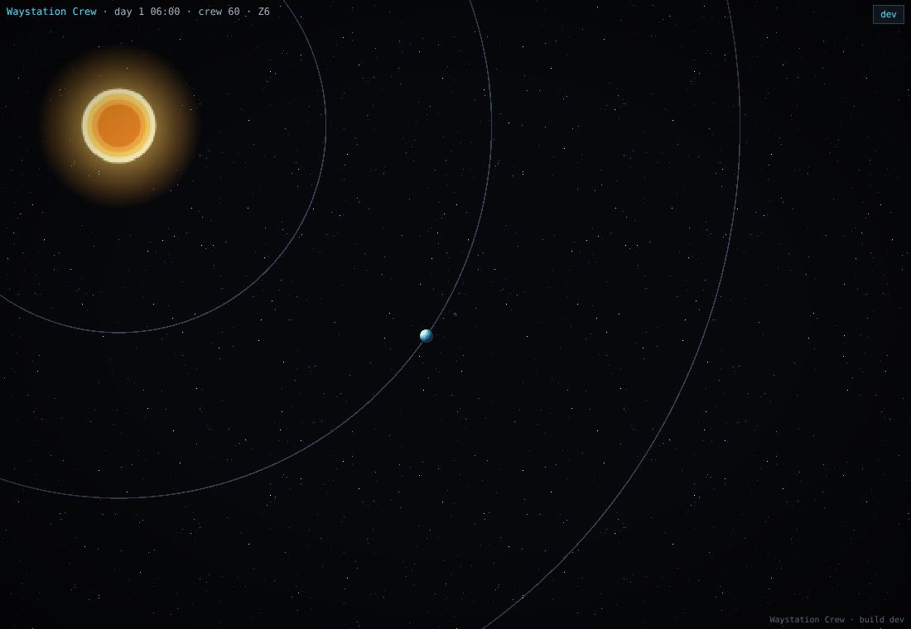

# Waystation Crew

[](https://github.com/Hound-Protocol/Waystation-Crew/actions/workflows/ci.yml)
[](https://github.com/Hound-Protocol/Waystation-Crew/actions/workflows/deploy.yml)

**A living space station you watch, not play.** Every crew member is an autonomous person with needs, a job, a shift and a mind of their own. Nobody is controlled; you just watch the station run, and the story writes itself.

**[Watch it live](https://hound-protocol.github.io/Waystation-Crew/)**



## What you'll see
- A pixel-art station that **builds itself as the crew grows**: rooms, corridors, furniture and decorations are generated by rules, not drawn by hand.
- Crew who eat, sleep, work their shifts and wander, driven by hunger, energy, social need and morale. Click a person to open their **PDA** and read their live status and what they're thinking.
- A real solar system behind it: a sun and planets orbiting in true proportions, with the home planet's year compressed into **one day**. Zoom out through six levels from a single character to the whole system.



## Coming next
Followers become crew. They arrive by train at a planetside outpost, fly to the station on a cargo ship, and leave the same way when they go. See the [concepts](docs/README.md).

## Run it yourself
Needs Node 22+ and pnpm 10.

```sh
pnpm install
pnpm dev          # viewer at http://localhost:5173
pnpm test         # simulation + renderer tests
pnpm typecheck
pnpm bench        # agent-count performance benchmark
```

## How it's built
A TypeScript monorepo, one codebase for the simulation and the viewer.

| Package | What it is |
| --- | --- |
| `packages/sim-core` | The deterministic simulation: station generator, crew AI, jobs and shifts. 1 tick = 1 sim second, same seed = same station. |
| `packages/protocol` | Messages between the simulation and the viewer. |
| `apps/viewer` | PixiJS renderer. The simulation runs in a web worker. |
| `tools/bench` | Performance benchmarks. |

Design docs and the working agreement live in [`docs/`](docs/README.md). Everything on screen must ease in and out: nothing pops in (spec section 10b).

## Contributing
Workflow: **concept, discussion, questions, implementation.** Write the idea down in `docs/superpowers/specs/` first. Tests come before code; `pnpm test` and `pnpm typecheck` must pass before a commit. See [CONTRIBUTING.md](CONTRIBUTING.md).
